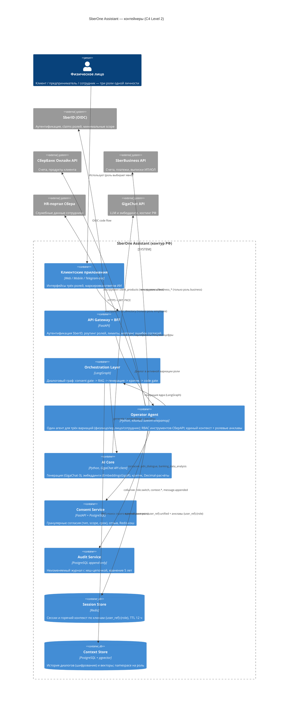

# 01. C4-диаграмма архитектуры (контейнерный уровень, C4 Level 2)

**Система:** SberOne Assistant — «Универсальный помощник Сбера»
**Одно физическое лицо — три роли:** `client` (СберБанк), `business` (СберБизнес), `employee` (сотрудник Сбера).
**Ключевой принцип:** изоляция контуров ролей + явный consent management (152-ФЗ, 395-1 ст. 26, ТК РФ ст. 86–88).

## Mermaid C4Container



## ASCII-версия (гарантированный рендеринг)

```
 ┌──────────────────────────── Пользователи ─────────────────────────────┐
 │  Одно физическое лицо:   [client]   [business]   [employee]           │
 └──────────────────────────────────┬────────────────────────────────────┘
                                    │ HTTPS + JWT (SberID)
 ┌──────────────────────────────────▼────────────────────────────────────┐
 │  [C1] Клиентские приложения: Web / Mobile / Telegram-бот              │
 │       Явный выбор роли, маркировка ответов ИИ                          │
 └──────────────────────────────────┬────────────────────────────────────┘
 ┌──────────────────────────────────▼────────────────────────────────────┐
 │  [C2] API Gateway + BFF (FastAPI)                                     │
 │   • SberID OIDC (code + PKCE), JWT-сессии                             │
 │   • Проверка доступных ролей (claims)                                 │
 │   • Rate-limit, маппинг ConsentRequiredError -> 403 + consent_url     │
 └──────┬───────────────────┬───────────────────┬───────────────────────┘
        │                   │                   │
 ┌──────▼───────────────────────────────────────┐ ┌──────▼─────────────┐
 │ [C3] Operator Agent — ЕДИНЫЙ агент-оператор  │ │ [C5] Audit         │
 │  три вариации одного агента:                 │ │ append-only,       │
 │   физлицо · юр.лицо · сотрудник              │ │ хеш-цепочка, 5 лет │
 │  • вариация = системный промпт + инструменты │ └────────────────────┘
 │  • RBAC инструментов СберAPI (SberToolReg.)  │
 │  • единый контекст: {user_ref}:unified       │
 │  • анклавы тайны: {user_ref}:{role}:enclave  │
 └──────┬──────────────┬───────────────┬────────┘
        │              │               │
 ┌──────▼───────┐ ┌────▼──────────┐ ┌──▼───────────────┐
 │ [C4] Consent │ │ [C6] LangGraph│ │ [C7] AI Core     │
 │ Service      │ │ consent gate→ │ │ GigaChat-3 Pro,  │
 │ гранулярные  │ │ RAG→генерация │ │ EmbeddingsGigaR, │
 │ согласия     │ │ →критик→calc  │ │ Decimal code gate│
 └──────────────┘ └───────────────┘ └──────────────────┘
        │                                 │
 ┌──────▼─────────────────────────────────▼─────────────────────────────┐
 │ [C8] Redis (сессии, единый контекст)  [C9] PostgreSQL + pgvector     │
 │  sess:{sid} · ctx:{user_ref}:unified   · messages (шифрование)       │
 │  ctx:{user_ref}:{role}:enclave         · embeddings (namespace)      │
 │  TTL 12 ч                              · consents · audit_log        │
 └──────────────────────────────────────────────────────────────────────┘

 Внешние системы (за границей доверия):
   SberID (OIDC) · СберБанк Онлайн API · SberBusiness API · HR-портал · GigaChat API
```

## Модель v2.1: один агент, один контекст, три вариации

| Аспект | Решение |
|---|---|
| Агент | **Один** `OperatorAgent` обслуживает все инструменты Сбера; между ролями переключается «оптика» |
| Вариация | = системный промпт + набор доступных инструментов (`SberToolRegistry`, RBAC по ролям) |
| Контекст | **Один на пользователя**: `{user_ref}:unified`, непрерывен при switch_role |
| Тайна | Общий слой — обесличенный; чувствительное — в анклавах `{user_ref}:{role}:enclave`, чужим ролям недоступно |
| Согласия | `pdn_dialogue:{role}` на обработку ПДн; `context_transfer:{role}->shared` на вывод анклава; `banking_data_analysis` на финансовые инструменты |

## Границы доверия и правила пересечения

| Граница | Правило пересечения |
|---|---|
| Пользователь → Gateway | Только аутентифицированный JWT; роли из claims SberID, не из тела запроса |
| Gateway → Operator Agent | Каждый запрос несёт `user_ref` (псевдоним) и активную роль; сырой SberID не покидает auth-модуль |
| Operator Agent → Инструменты | RBAC: инструмент доступен только ролям из `allowed_roles` + проверка согласия перед вызовом |
| Operator Agent → Data | Единый контекст `{user_ref}:unified` (обесличенный); анклавы `{user_ref}:{role}:enclave` — только своей роли; SQL-фильтр по namespace |
| Operator Agent → GigaChat | В промпт уходит обесличенный контекст активной «оптики»; реквизиты замаскированы |
| Роль → Анклав чужой роли | Запрещён всегда (банковская тайна 395-1 ст. 26, ТК РФ ст. 88); вывод записи в общий слой — только обесличенно и по согласию `context_transfer` |
| Employee-контур → Любой внешний | Запрещён (ТК РФ ст. 88): служебные данные не покидают контур работодателя |
