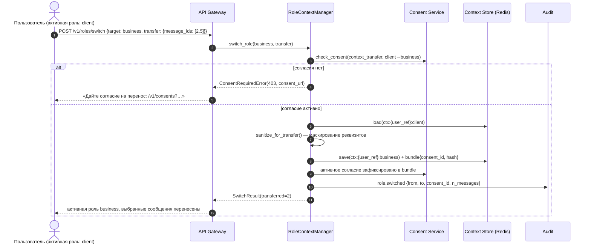
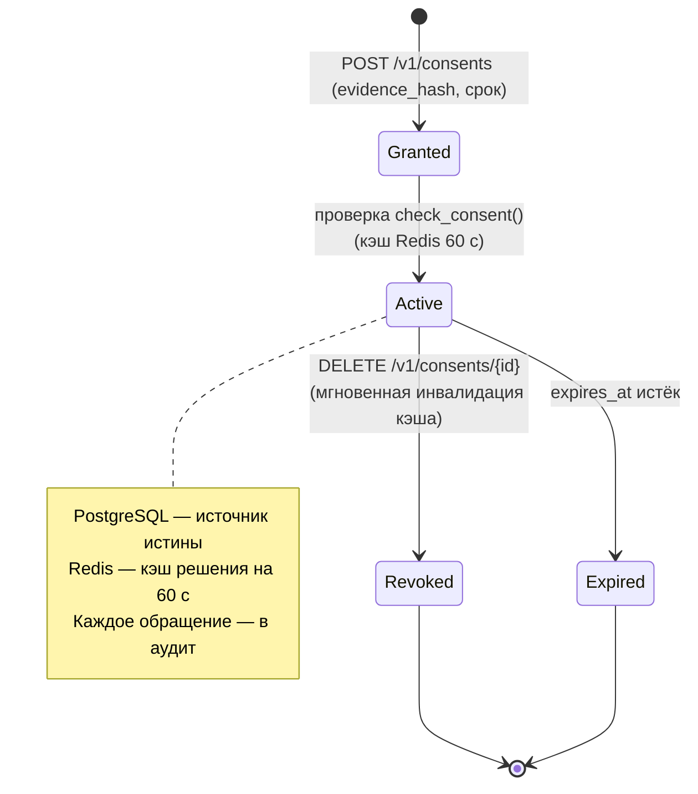

# 02. Схема потоков данных с учётом согласий (v2.1 — единый контекст)

## Модель согласий

| Код | Согласие | Scope | Юридическое основание | Куда применяется |
|---|---|---|---|---|
| `pdn_dialogue:{role}` | Обработка ПДн в диалогах роли | значение роли (`client` / `business`) | 152-ФЗ ст. 9 (для `employee` — ТК РФ ст. 86, согласие не требуется) | `get_context()`, запись истории, эмбеддинги |
| `context_transfer:{role}->shared` | Вывод записи анклава в общий слой | `{role}->shared` | 152-ФЗ ст. 9 (отдельная цель обработки) | `promote_to_shared()` |
| `banking_data_analysis` | Чтение данных счетов для анализа | имя инструмента (`business_accounts`, …) | 152-ФЗ ст. 9 + 395-1 ст. 26 (режим БТ) | финансовые инструменты агент-оператора |
| `ml_improvement` | Использование обезличенных данных для дообучения | `anonymized` | 152-ФЗ ст. 9 (отдельная цель) | пайплайны качества |

Согласие хранится в PostgreSQL (источник истины), кэшируется в Redis на 60 с; `revoked_at`/`expires_at` проверяются при каждом `check_consent()`.

## Основной поток: диалог в роли (Mermaid)

```mermaid
flowchart TD
    U[Физическое лицо] -->|"SberID OIDC (code+PKCE), минимальные scope"| AUTH[Auth: JWT-сессия, claims ролей]
    AUTH --> PSEU[Псевдонимизация: user_ref = HMAC-SHA256(user_id)]
    PSEU --> SW{Активная роль<br/>из сессии}

    SW -->|client| G1{"G1: consent<br/>pdn_dialogue:client"}
    SW -->|business| G2{"G2: consent<br/>pdn_dialogue:business"}
    SW -->|employee| E["Правовое основание:<br/>трудовой договор (ТК РФ ст. 86)<br/>согласие не используется"]

    G1 -->|нет| R403["403 consent_required<br/>+ ссылка на форму согласия"]
    G2 -->|нет| R403
    G1 -->|да| CTX
    G2 -->|да| CTX
    E --> CTX

    CTX["get_context(role)<br/>Redis: ctx:{user_ref}:{role}"] --> Q[Вопрос пользователя]
    Q --> AUD1["Аудит: message.append<br/>(событие + хеш)"]
    Q --> VDB["RAG-поиск строго в<br/>namespace {user_ref}:{role}<br/>(pgvector, фильтр в SQL)"]
    Q --> SAN["Маскирование реквизитов<br/>(счета/карты/телефоны)"]
    SAN --> LLM["GigaChat: генерация черновика"]
    VDB --> LLM
    LLM --> CR["Критик: проверка на<br/>выдумки и юрид. корректность"]
    CR -->|needs_calculation| DEC["Decimal-расчёт<br/>(code gate, без LLM)"]
    CR -->|pass| OUT
    DEC --> OUT["Ответ пользователю<br/>(маркировка «ИИ-ответ»)"]
    OUT --> AUD2["Аудит: ai.response"]

    LLM -.->|"псевдонимизированный<br/>промпт, без raw ПДн"| GIGA_EXT[GigaChat API, РФ]
```

## Поток переключения роли с переносом контекста



## Состояния согласия и хранение



## Карта хранилищ и изоляции (v2.1 — единый контекст + анклавы)

| Хранилище | Ключ / namespace | Что лежит | ПДн? | Основание |
|---|---|---|---|---|
| Redis | `sess:{session_id}` | user_ref, active_role, TTL 12 ч | нет (псевдоним) | исполнение сервиса |
| Redis | `ctx:{user_ref}:unified` | **единая история всех ролей** (обесличенная) | да, маскированные | `pdn_dialogue:{role}` |
| Redis | `ctx:{user_ref}:{role}:enclave` | чувствительные записи анклава роли (сырые) | да, зашифровано | роль + банковская тайна / ТК РФ |
| PostgreSQL | `messages` | long-term история, `content_enc`, `content_hash` | да, зашифровано | `pdn_dialogue:{role}` |
| PostgreSQL | `embeddings` | векторы, `namespace={user_ref}:{role}` | да (векторы ПДн) | `pdn_dialogue:{role}` |
| PostgreSQL | `consents` | согласия: тип, scope, срок, отзыв, evidence_hash | метаданные | 152-ФЗ ст. 9 |
| PostgreSQL | `audit_log` | события + хеш-цепочка | псевдонимы | 152-ФЗ ст. 18.1 ч. 2 |
| GigaChat | промпты запросов | обесличенный контекст активной «оптики» | нет raw ПДн | поручение оператору |

**Ключевые правила:**
1. **Контекст один на пользователя** (`{user_ref}:unified`): при переключении ролей история непрерывна — «переносить» нечего, меняется только видимость анклавов и вариация агент-оператора.
2. Общий слой хранится **обесличенным** (маскирование реквизитов при записи) — безопасен во всех ролях.
3. **Анклав роли** (`{user_ref}:{role}:enclave`) виден только этой роли; вывод записи в общий слой — только через `promote_to_shared()` при согласии `context_transfer:{role}->shared` и после маскирования.
4. Роль — часть namespace RAG-индексов; SQL-фильтр по namespace обязателен (защита на уровне данных, не только кода).
5. Employee-контур закрыт для внешних систем (ТК РФ ст. 88) и не отдаёт данные в GigaChat-логи дольше необходимого.
